# AIがBlenderで作った町

AIとBlenderで制作した未来都市「AURORA」の3Dデータと、銀河鉄道で別の星へ行けるオフライン散策版です。

## 散策版を起動

リポジトリをダウンロード・展開し、`walk/index.html` を最新版のEdgeまたはChromeで開きます。「街を歩き始める」をクリックしてください。インターネット接続や追加インストールは不要です。`walk` フォルダー内のファイルはまとめて保持してください。

| 操作 | キー |
| --- | --- |
| 移動 | WASD または矢印 |
| 見回す | マウス（固定されない場合はドラッグ）、またはQ/E |
| 早歩き | Shift |
| 銀河鉄道への乗車・到着後の降車 | 駅でF、または画面下の乗降ボタン |
| 休憩・カーソル解除（銀河鉄道も停止） | Esc |
| 街の出発地点へ戻る・旅をリセット | R |
| 建物の選択・昼夜切り替え | 右上「街の案内」 |
| 自分の庭・家具を配置 | Bで編集、Pで配置、Tで45°回転、Deleteで近くを撤去、Zで取り消し |
| ジャンプ | 地上でSpace（LUMENは低重力）。ドローン中は上昇 |
| エネルギーパルス | J、画面右下のボタン、または短い左クリック |
| 近くの人・機械人と会話 | C、または会話ボタン。Escで会話を終了 |

歩行者46人の骨格アニメーション、3人の店員、2人の学園案内係、建物の衝突判定、自分の体の表示を備えています。大通り沿い8棟の1階に入館できます。自動ドアは近づくと開きます。各棟のエレベーターから展望ラウンジと屋上庭園にも移動できます。

## 3つの星を歩いて巡る（v0.8）

「街の案内」→「3つの星の見どころ」から、**今いる星**の新しい場所へ移動できます。他の星へは銀河鉄道を使ってください。

- **AURORA**：大きな科学・芸術学園。中庭、左右の教室、ロボット研究室に入れます。机、椅子、教材端末、自転車、スポーツコート、屋上の太陽光パネルまで制作。案内係とも会話できます。東には**標高182mのアスター山**を追加し、曲がる登山道、林、休憩デッキ、山頂の望遠鏡を配置。背景の山ではなく、実際に登れる地形です。
- **LUMEN**：巨大望遠鏡を持つ深宇宙天文台、23の石弧からなる「歌う結晶の門」、異星植物を育てる段々畑。門の近くでFを押すと、合成した共鳴音が変化します。施設内や入口に自然の岩・結晶が重ならないよう配置を調整しました。
- **NEXUS-9**：金属パネル、保守ハッチ、換気グリル、ボルト、銅の配管、警戒線、誘導灯を持つ機械甲板。空飛ぶ車の工廠を追加し、6台の定期便が上空を飛びます。工廠の乗り場で**Fを押すと自分でも操縦**できます。WASDで飛行、Spaceで上昇、Xで下降。Fで工廠へ自動着陸します。飛行範囲は星港周辺の半径185m、高度26〜115m。建物・工廠の構造物を避けて飛べます。
- **旅の記録**：9つの見どころでFを押して記録を集めます。記録はブラウザーに保存され、9地点すべてを巡ると「3つの星の旅人バッジ」を表示します。

新しい形状は**Blenderで制作してGLBに書き出し、そのモデルを散策版に読み込んでいます**。`scripts/create-worlds.py`が制作スクリプト、`models/worlds.glb`が書き出したモデル、`src/landmark-layout.json`が同時に生成した衝突・床・案内情報です。

### 細部を保った軽量化

- 静止した不透明部品を材質と区画ごとにまとめて描画。動く列車、車、エレベーター、機械人、回転部品、透明な窓は個別に保持しています。
- 元の都市の頂点を、位置・法線・UVの全ビットが一致する場合だけ共有。**2,229,060頂点から1,730,216頂点へ約22%削減**し、面の形やテクスチャの継ぎ目を保持しました。区画外の三角形は視界に応じて描画します。
- 探索中の星と、銀河鉄道で接近した星の施設を描画。遠い別の星の施設を同時に描く負荷を抑え、惑星の全球・星空・長い軌道・走行中の列車は表示を継続します。
- 画面内に光が届く点光源を共有プールへ移します。影響する光源が多い場合は枠を増やし、必要な光を上限で切り捨てません。
- 標準の解像度・影の設定は維持しています。このPCの出発地点での比較では、描画回数は従来の1,357回から約1,050回へ減少しました。交通や視点によって変動し、FPSの保証値ではありません。

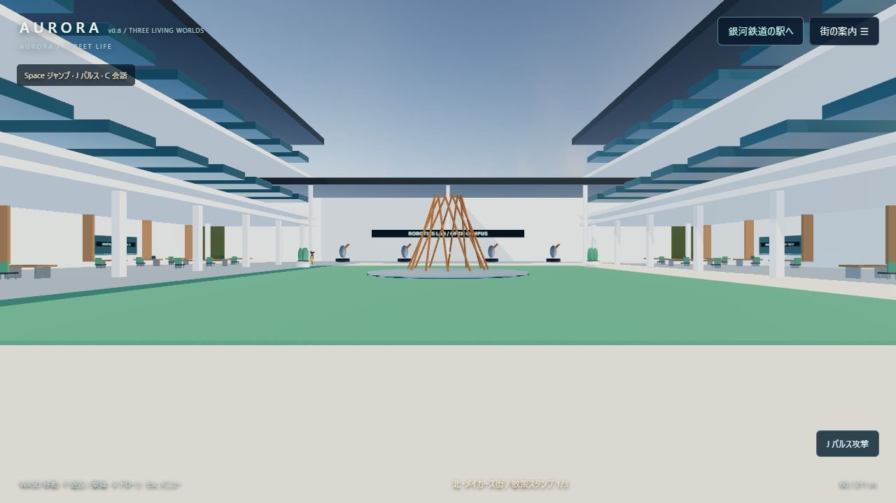

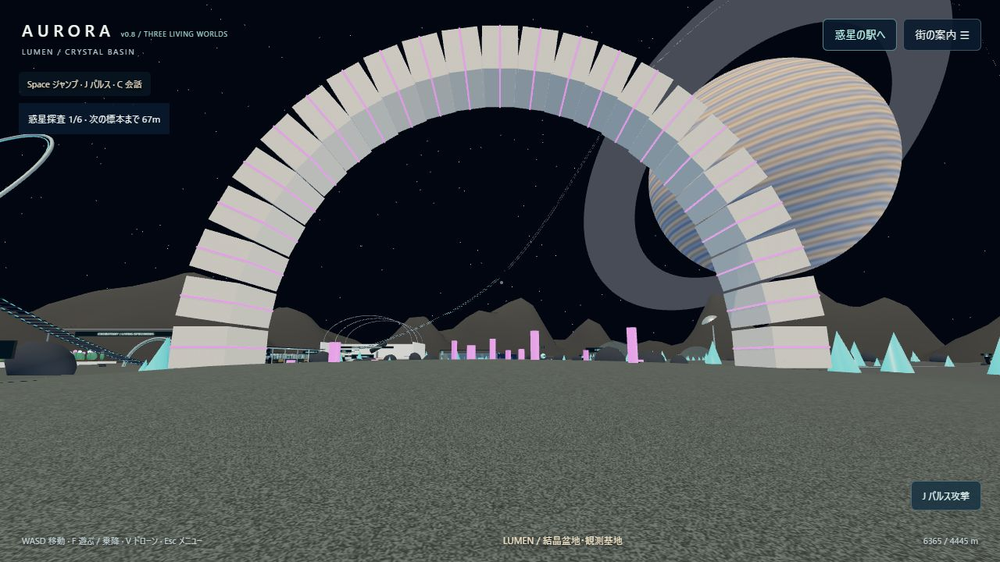

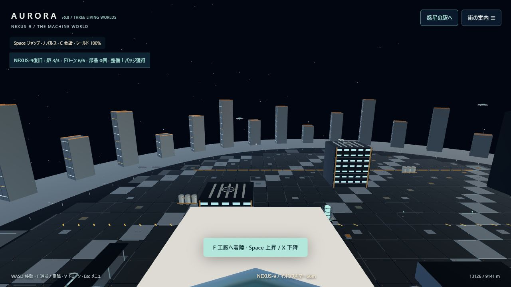

## ジャンプ・パルス・会話・機械惑星（v0.7）

**AURORA → LUMEN → NEXUS-9** と銀河鉄道で旅ができます。まず都市の駅からLUMENへ。LUMENで降車後、「街の案内」→「銀河鉄道の行き先」から **機械惑星 NEXUS-9** を選び、駅でFを押してください。新しい区間は約38秒で、往復ともスキップできます。帰りはNEXUS-9→LUMEN→AURORAです。

- **ジャンプ**：徒歩でSpace。上昇・落下・着地を計算し、空中での連続ジャンプはできません。LUMENでは低重力になります。機械惑星の低い整備ブロックには飛び乗って立てます。既存の都市の壁や柵の衝突判定も保持しています。
- **パルス攻撃**：J、攻撃ボタン、短い左クリックで視線方向へ発射。射程24m、約0.32秒間隔、ターゲットは3発で停止。壁越しの命中はしません。「街の案内」のパルス訓練場で試せます。訓練ターゲットは6秒で戻り、スコアを表示します。住民に当たると短いリアクションを返します。
- **機械の星**：金属の全球パネル、赤道の溝と発光帯を持つ巨大な球体に、星港と工業区を追加。管路、タンク、換気ファン、動力炉、中央アーカイブ、8人の機械人がいます。徒歩の探索範囲は星港周辺の半径約197mです。惑星の裏側まで歩く球面移動ではありません。
- **復旧ミッション**：光る修復部品へ近づいてジャンプし、部品を回収。各炉にいる故障ドローン2機をパルスで停止し、炉の端末でFを押すと部品1個を使って修復します。3基の修復後は中央アーカイブの扉が開くので、内部でFを押して星の記憶と整備士バッジを受け取れます。バッジ獲得後は機械惑星でのShift移動が速くなります。
- **戦闘と探索の支援**：ドローンは17m以内でシールドを攻撃します。攻撃を受けずに8秒経つと徐々に回復。シールドが尽きると修復の進行を保持して星港へ戻ります。「街の案内」のNEXUS-9の探索リストから部品の回収場、作業区、端末、アーカイブ入口にも移動できます。進行はこのブラウザーに保存します。
- **会話**：都市の住民、LUMENに追加した3人の研究員、機械人の近くでC。場所・仕事・旅・操作・雑談の選択肢と、短いキーワード入力に応答します。機械惑星の返答には修復状況を反映。固定会話なのでローカルLLMの起動や外部への通信は不要です。
- **Blender**：`13 | NEXUS-9 / MACHINE PLANET AND OUTER RAIL` に惑星・機械人・延伸区間・列車のアニメーションを収録。`NEXUS-9 / visitor view` カメラから工業区を見られます。ジャンプ、攻撃、会話、ミッションはブラウザー版の機能です。

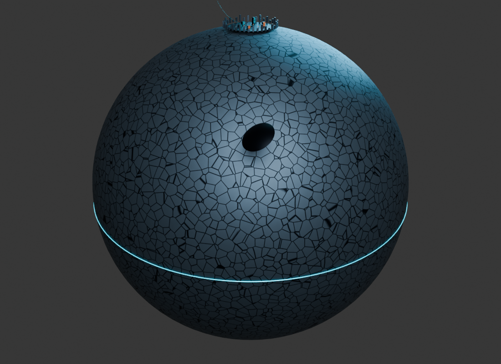

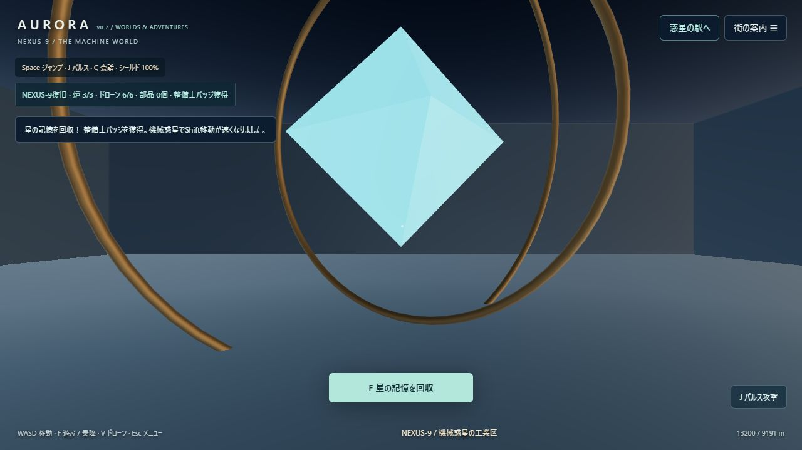

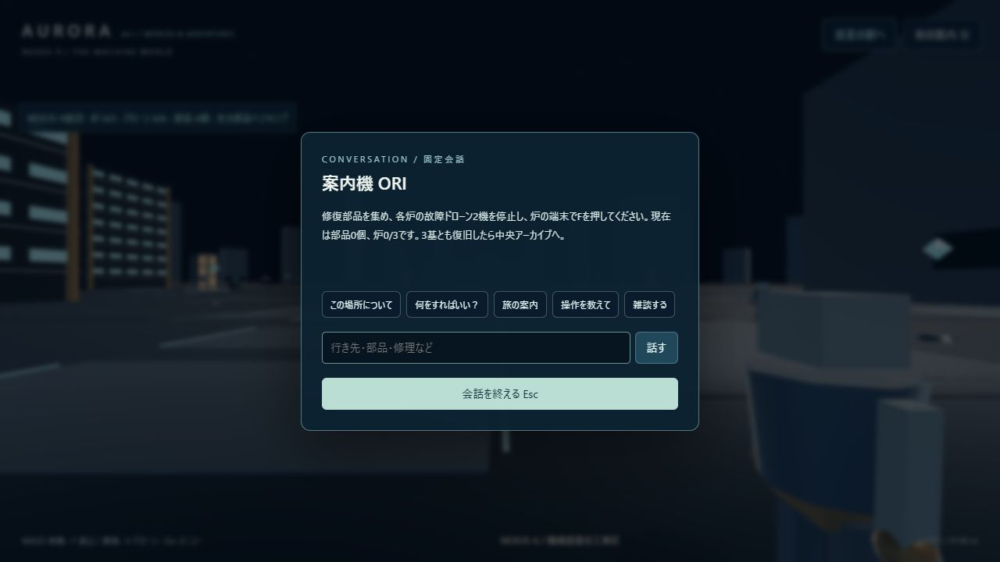

## 自分の街をつくる・運河ボート・景観改善（v0.6）

- **街の編集**：「街の案内」から「自分のガーデンを作る広場」へ移動し、Bで編集モード。樹木、花壇、ベンチ、街灯、光の彫刻、パーゴラ、動く噴水から選び、視線の先5mにPで配置できます。WASDで場所を調整、Q/Eで見回し、Tで45°回転。緑が配置可、赤が配置不可です。都市の地上の空いた場所で使え、道路・水面・建物・他の配置物との重なりを避けます。
- **保存とやり直し**：最大60個をこのブラウザーに自動保存。8m以内の自分の配置物をDeleteで撤去、Zで20操作まで取り消せます。元の街の建物や設備は編集対象ではありません。配置JSONの書き出し・読み込みもでき、別のブラウザーへ持ち運べます。読み込んだ配置も取り消せます。ブラウザーのデータを消す前はJSONを書き出してください。自分で置いたベンチにもFで座れ、街灯は夜に近くを照らします。
- **運河ボート**：地区リストの船着き場でF。W/Sで前後、A/Dで操舵し、Fで岸の船着き場へ戻ります。橋と護岸で停止します。初期のボートは南側の2本の橋の間の水域を航行する小型艇です。宇宙・陸上には進めません。停泊位置はその起動中に保持します。
- **樹木と外周**：外周の単一の塊だった木を、枝と23個の葉の集まりを持つ形に置き換え、葉のわずかな揺れと地面の柔らかな影を追加。ビルの裏・側面の枠、屋上の縁、対岸の窓枠や庇、マーケットの品物と吊り照明も追加しました。
- **水・光・品質**：水面の細かな波をアニメーションし、環境光の映り込みを表現。夜の運河・マーケットには近くの照明と地面の光を加え、夕景では影の角度が変わります。高精細は影の解像度も上げます。水面は環境マップを利用し、建物を正確に鏡写しにする方式ではありません。
- **Blender**：更新した外周形状はコレクション11、枝のある樹木とボート・船着き場は `12 | FREE CITY / BRANCHED TREES AND CANAL BOAT` に収録。配置編集・操作・ローカル保存・噴水の動作はブラウザー版です。

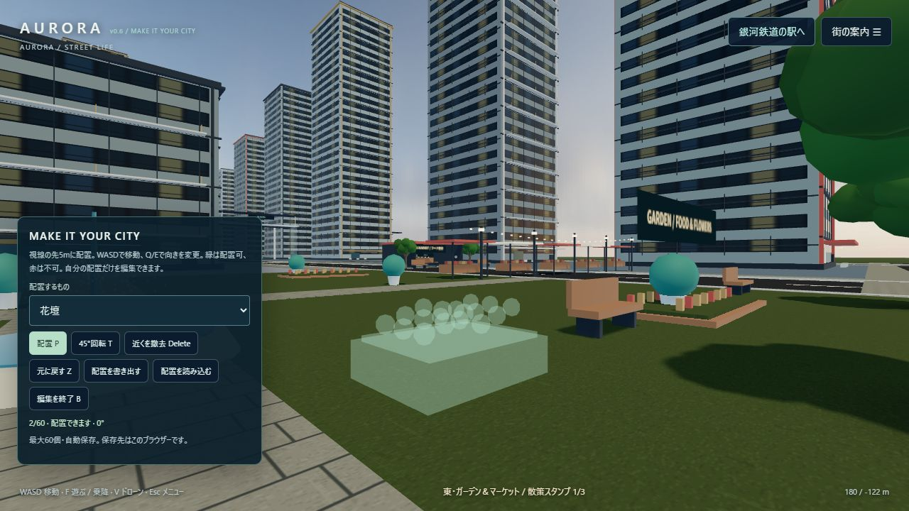

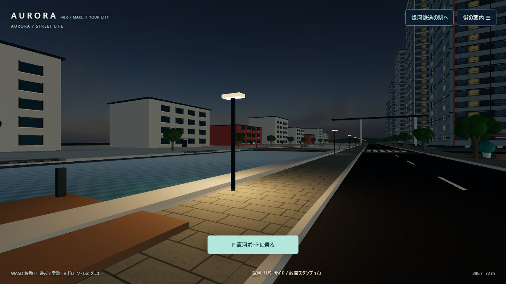

## 外周の景観・自由な散策（v0.5）

- 運河プロムナードと対岸、東のフードマーケット、北の工房ギャラリーを追加。41棟の外周ビルに窓の明暗、庇、バルコニー、手すり、屋上設備、店先を加えました。歩道の舗装、縁石、横断歩道、道路のラインも追加しています。
- 「街の案内」→「地区を探索」から各地区・店の入口・シティカー乗り場へ移動できます。
- **シティカー**：近くでF、W/Sで前後、A/Dで操舵、Fで降車。簡易運転モードです。建物・設備・走行中の車には衝突判定があります。
- **ドローン視点**：地上でV。WASDで水平移動、Spaceで上昇、Xで下降。高度3〜220mの自由カメラです。FまたはVで離陸前の地上位置に戻ります。地上の移動とは異なり建物を通り抜けて見回せます。
- **店と休憩**：店の入口でFを押すとカフェ・フード・展示の散策スタンプを集められます。スタンプはブラウザーに保存。ベンチ付近のFで座り、再びFで立ちます。
- **写真・天候・品質**：「街の案内」で風景写真をPNG保存、晴れ／夕景／雨を切り替えできます。写真は3Dの風景のみで操作パネルを含みません。軽量／標準／高精細の描画品質も選べます。雨と夕景は景観表現で、水位や運行条件は変わりません。
- 追加の細部は共有ジオメトリでまとめて描画。Blender版は `11 | LIVING DISTRICTS / CANAL MARKET MAKERS` に形状を収録しています。ブラウザー専用の天候、舗装シェーダー、操作などとは描画の差があります。

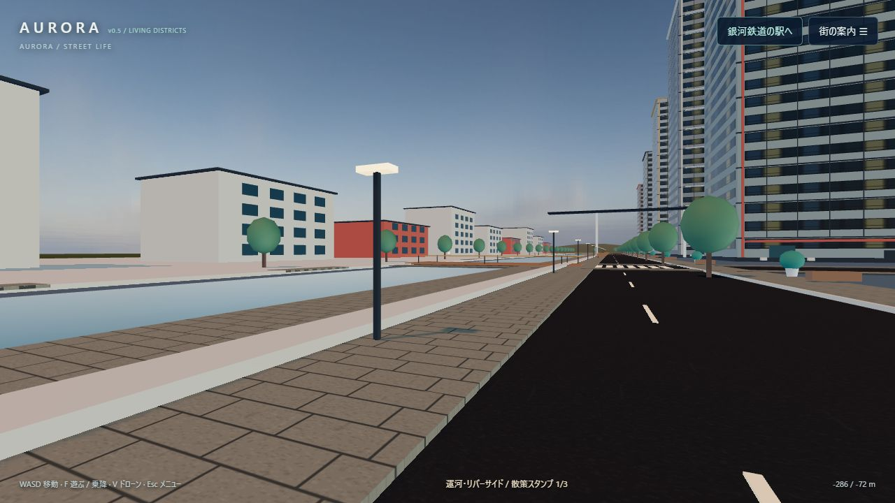

### v0.4の機能

- 外周の探索範囲を620m×465mへ拡張し、新しいビル41棟と公園、歩行者24人を追加しました（合計46人）。外周の新しいビルは外観・衝突判定が中心です。
- 「街の案内」から市内電車の駅を選べます。既存の東西の高架電車を3駅の路線にし、停車中にFで乗降できます。運行は各駅8秒停車、次駅まで22秒。地上の駅用エレベーター付近でもFでホームへ上がれます。
- 銀河鉄道の乗車中は「移動をスキップ → 到着」で待たずに到着できます。帰りも使えます。
- 既存8棟の1階に展示・植栽・照明を加え、入口の奥にエレベーターを設けました。付近でF→「1F ロビー」「展望ラウンジ」「屋上庭園」を選ぶと約5秒で移動します。ラウンジや庭園を歩けます。中間階の全室を探索する方式ではありません。
- LUMENにはローバー、6か所の探査ビーコン、共鳴遺跡、動く惑星儀を追加。ローバー付近でF、WASDで運転、Fで降車。未調査ビーコンの近くでFを押すと記録し、6件を集めて惑星儀を調べると星図復元の完了メッセージが出ます。探査記録はこのブラウザー内に保存されます。
- Blenderの拡張形状は `10 | EXPANDED CITY / UPPER FLOORS` コレクション。操作・ミッション・スキップはブラウザー版の機能です。

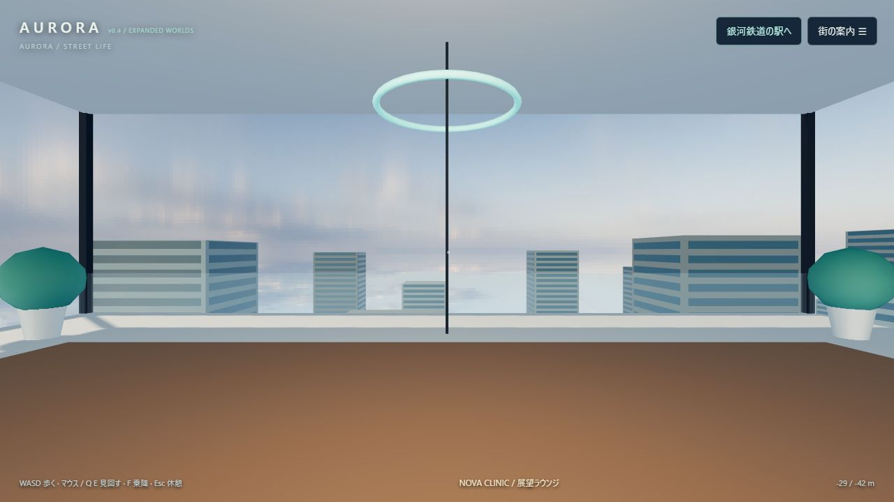

### 銀河鉄道の乗り方

1. 右上の「銀河鉄道の駅へ」を押すか、西側の駅まで歩きます。
2. 乗り場でF、または「LUMEN行きに乗車」を押します。
3. 約76秒で都市の軌道から上昇し、宇宙を通って惑星LUMENに着きます。車内の席からマウスやQ/Eで車窓を眺められます。
4. 到着後にF、または「降りて探索する」を押します。地形・結晶・観測基地・温室・クレーター・環のある惑星の空を探索できます。
5. 「帰りの駅へ」から駅に戻り、「AURORA行きに乗車」で帰還できます。

散策できるのはLUMENの着陸区域（半径約197m）です。惑星全体の自由飛行や、温室内の探索は含みません。乗車中は車内の固定席から見回す方式です。Rでいつでも都市へ戻れます。

人物モデルの足先から正面方向を判定し、2種類のモデルで正面が逆なために一部が後ろ向きに歩いていた問題を修正しました。自分の体の向きも合わせています。

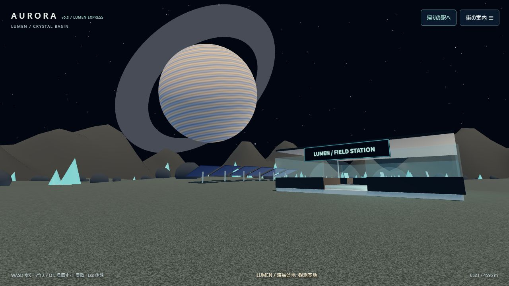

## 交通と入れる建物（v0.2）

- 車8台が対向車線を走行し、車輪も回転します。信号・前走車・道路を横切るプレイヤーに応じて減速します。
- 高架列車も走行します。
- 診療所、カフェ、オフィスロビー、ギャラリー、ショップ、図書室など8棟の1階を探索できます。
- 建物の入口からWASDで入館します。自動ドア、壁、受付、テーブル、椅子には衝突判定があります。
- Escで休憩して右上の建物リストから行き先を選び、「建物の入口へ」を押すと入口の外へ移動できます。
- 館内の照明と室名表示を追加し、夜の視認性を改善しました。

## 散策版の開発

実装は`src/`、固定したThree.jsの依存コードは`vendor/` に収録しています。モデルとテクスチャを含む`walk/data.js`は既存のオフライン用データです。新しいBlenderモデルは`walk/landmarks.js`に埋め込んでいます。どちらも起動時の外部通信を必要としません。

`npm install` の後、`npm test` で交通・衝突・自動ドアのテスト、`npm run build` で`walk/app.js`と`walk/landmarks.js`の再生成ができます。新モデルを作り直す場合は、Blender 5.1以降で`blender --background --python scripts/create-worlds.py`を実行してからビルドしてください。

## Blenderデータ

`blender/AURORA_REAL.blend` をBlender 5.1以降で開きます。テクスチャは同梱済みです。**同じフォルダーに`AURORA_WORLDS.blend`も置いてください。** v0.8の新施設は、この別ファイルを相対パスでリンクした`14 | THREE WORLDS / BLENDER LANDMARKS`コレクションにあります。`V8 / Academy`、`V8 / Aster massif`、`V8 / Lumen astronomy`、`V8 / Nexus aeroworks`のカメラも追加しています。新しい模型だけを編集する場合は`AURORA_WORLDS.blend`を開けます。スペースキーで人物の歩行と銀河鉄道を再生できます。銀河鉄道・惑星は `09 | GALAXY RAILWAY / LUMEN` コレクション、惑星の視点は `LUMEN / visitor view` カメラにあります。F3から「Walk Navigation」を選ぶとBlender内でも視点を動かせます。

ブラウザー版には地面の細かな質感や車窓UIなど独自の描画があります。Blender版とブラウザー版では追加設備の細部が異なります。

## 使用素材

- 街の形状・建築・設備：本プロジェクト用に作成。
- 路面、コンクリート、空： [Poly Haven](https://polyhaven.com/license)、CC0。`asphalt_02` / `concrete_wall_003` / `kloppenheim_06_puresky`。
- 人物： [Three.js公式サンプル](https://threejs.org/examples/webgl_animation_skinning_blending.html) のSoldierとMichelle、原モデル・動作はMixamo。Michelleの歩行は骨格に合わせて移植しています。人物モデルの単体素材としての再配布には使用元の条件を確認してください。
- 散策用ライブラリ：Three.js、MIT。`walk/THREE-LICENSE.txt` を参照。
