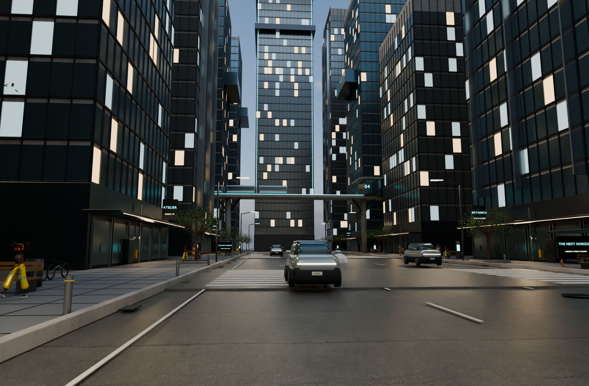
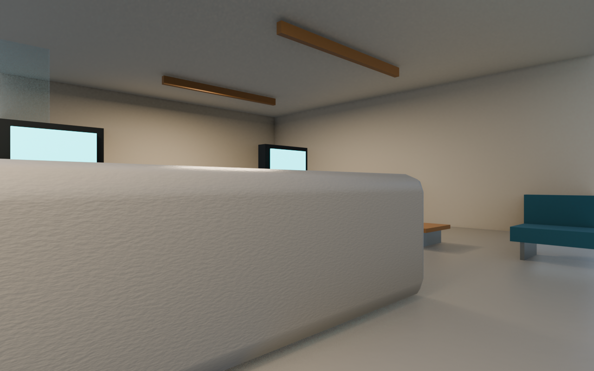

# AIがBlenderで作った町

AIとBlenderで制作した未来都市「AURORA」の3Dデータと、街を歩けるオフライン散策版です。

## 散策版を起動

リポジトリをダウンロード・展開し、`walk/index.html` を最新版のEdgeまたはChromeで開きます。「街を歩き始める」をクリックしてください。インターネット接続や追加インストールは不要です。`walk` フォルダー内のファイルはまとめて保持してください。

| 操作 | キー |
| --- | --- |
| 移動 | WASD または矢印 |
| 見回す | マウス（固定されない場合はドラッグ）、またはQ/E |
| 早歩き | Shift |
| 休憩・カーソル解除 | Esc |
| 出発地点へ戻る | R |
| 昼夜切り替え | Escで休憩して右上のボタン |

歩行者22人の骨格アニメーション、建物の衝突判定、自分の体の表示を備えています。大通り沿い8棟の1階に入館できます。自動ドアは近づくと開きます。上層階は探索範囲に含みません。

## 交通と入れる建物（v0.2）

- 車8台が対向車線を走行し、車輪も回転します。信号・前走車・道路を横切るプレイヤーに応じて減速します。
- 高架列車も走行します。
- 診療所、カフェ、オフィスロビー、ギャラリー、ショップ、図書室など8棟の1階を探索できます。
- 建物の入口からWASDで入館します。自動ドア、壁、受付、テーブル、椅子には衝突判定があります。
- Escで休憩して右上の建物リストから行き先を選び、「建物の入口へ」を押すと入口の外へ移動できます。
- 館内の照明と室名表示を追加し、夜の視認性を改善しました。

## 散策版の開発

実装は`src/`、固定したThree.jsの依存コードは`vendor/` に収録しています。モデルとテクスチャを含む`walk/data.js`は既存のオフライン用データです。

`npm install` の後、`npm test` で交通・衝突・自動ドアのテスト、`npm run build` で`walk/app.js`の再生成ができます。

## Blenderデータ

`blender/AURORA_REAL.blend` をBlender 5.1以降で開きます。テクスチャは同梱済みです。スペースキーで人物の歩行を再生できます。F3から「Walk Navigation」を選ぶとBlender内でも視点を動かせます。

## 使用素材

- 街の形状・建築・設備：本プロジェクト用に作成。
- 路面、コンクリート、空： [Poly Haven](https://polyhaven.com/license)、CC0。`asphalt_02` / `concrete_wall_003` / `kloppenheim_06_puresky`。
- 人物： [Three.js公式サンプル](https://threejs.org/examples/webgl_animation_skinning_blending.html) のSoldierとMichelle、原モデル・動作はMixamo。Michelleの歩行は骨格に合わせて移植しています。人物モデルの単体素材としての再配布には使用元の条件を確認してください。
- 散策用ライブラリ：Three.js、MIT。`walk/THREE-LICENSE.txt` を参照。
